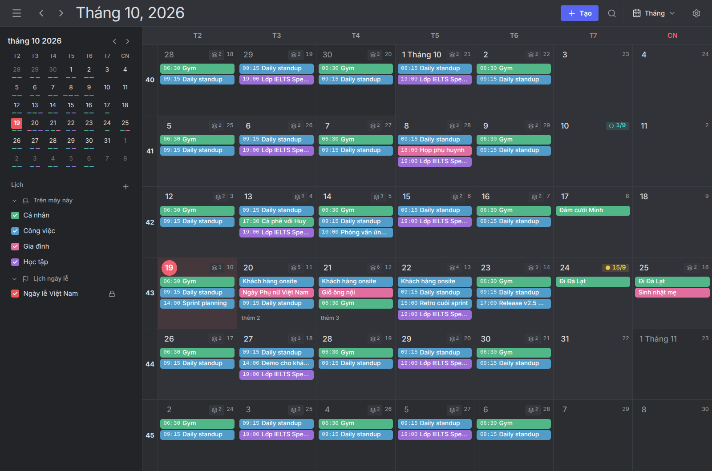
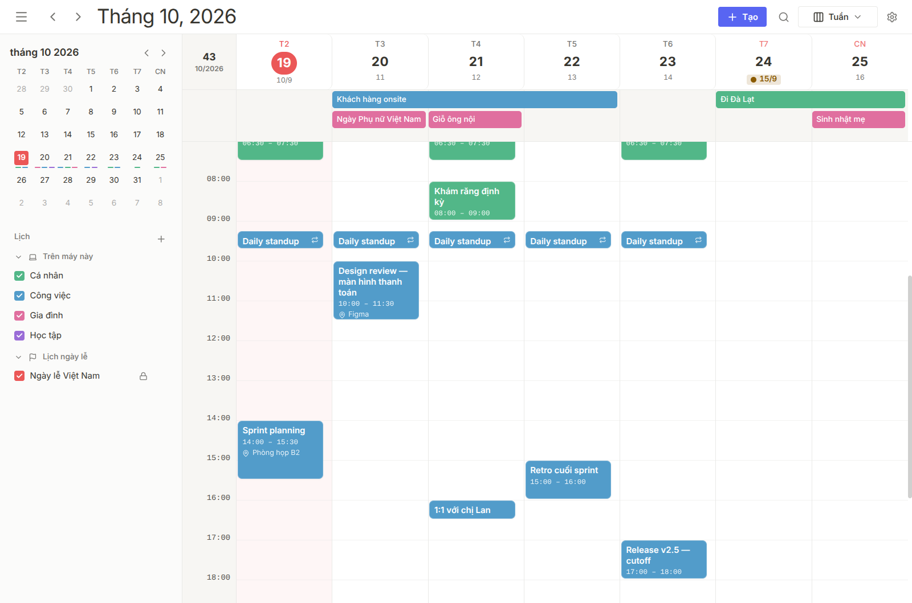
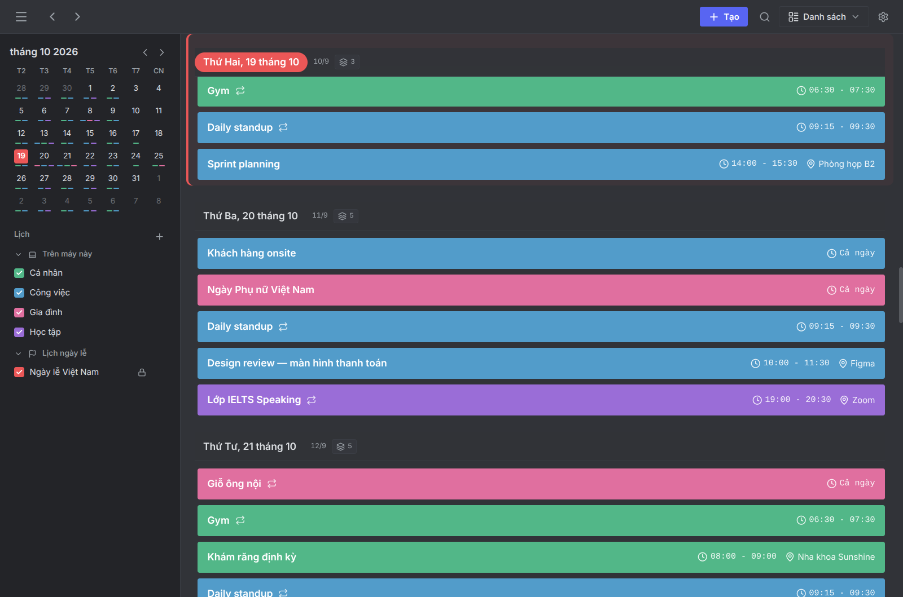
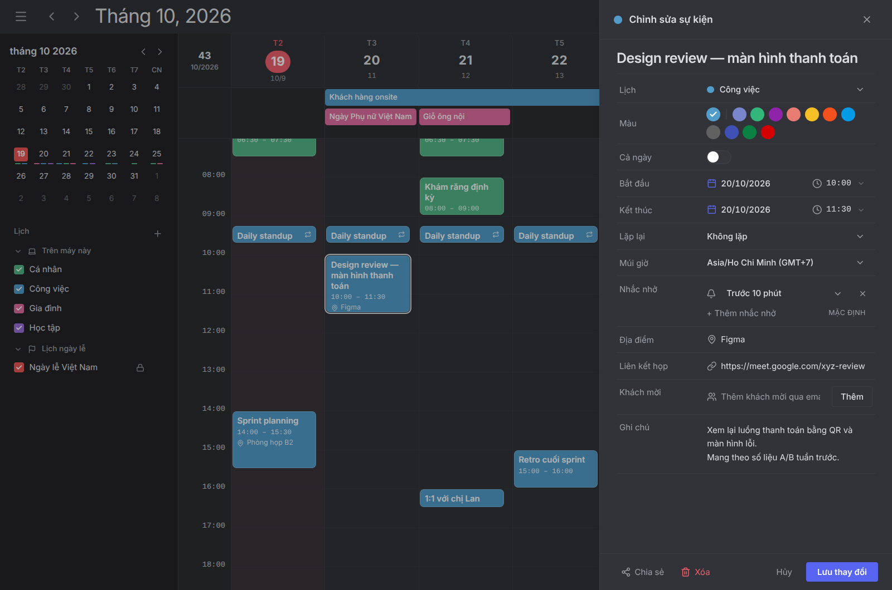
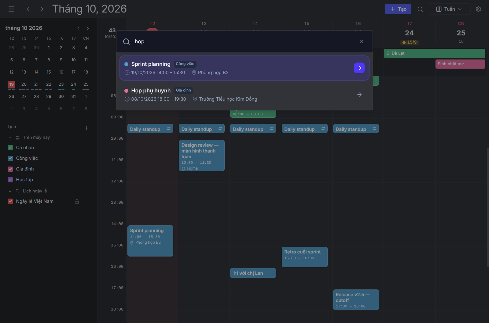
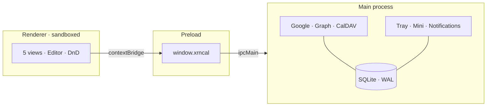

<p align="center">
  
</p>

<h1 align="center">xrncal</h1>

<p align="center">
  <strong>A local-first desktop calendar for Windows and Linux.</strong><br>
  Google, Microsoft 365 and CalDAV in one window — with <em>Vietnamese lunar dates</em> and <em>lunar-year anniversaries</em>.
</p>

<p align="center">
  
  
  
  
  
  
</p>

<p align="center">
  
</p>

<p align="center">
  <strong>English</strong> · <a href="README.vi.md">Tiếng Việt</a>
</p>

<p align="center">
  <a href="#why-not-just-use-your-existing-calendar">Why this?</a> ·
  <a href="#screenshots">Screenshots</a> ·
  <a href="#install">Install</a> ·
  <a href="#features">Features</a> ·
  <a href="#architecture">Architecture</a> ·
  <a href="#development">Development</a>
</p>

---

## Why not just use your existing calendar

Most calendar apps are **a client for one service**, or **a web tab in a wrapper**. xrncal works the other way round: your data lives in SQLite on your machine, and providers are just somewhere to push it to and pull it from.

### 1. The lunar calendar is a first-class citizen, not a plugin

This is the reason the app exists.

- Lunar day labels appear in **every view** — month cells, week and day headers, list groups, the year grid. Mùng 1 and rằm are marked, each with its own colour and shape.
- **Giỗ / anniversaries that repeat by the lunar year** are a real event type. You declare *"the 12th day of the 8th lunar month"* and the app resolves the Gregorian date for **each year**, handling leap months and short 29-day months.
- Google Calendar, Outlook and Apple Calendar have no lunar recurrence rule at all. There, the only option is to look each year up and create it by hand — miss one and the whole series drifts.
- Those anniversaries are **materialised** into an ordinary event in a synced calendar, so your phone and your colleagues still see them even though they don't run xrncal.
- A new anniversary **reminds you the day before at 09:00** - enough notice to buy the offerings - and the reminder syncs to your phone with it.

### 2. Offline is the default, not a degraded mode

SQLite is the **source of truth for the UI**. With no network you can still browse, create, edit and delete; changes are marked `dirty = 1` and pushed when you are back online. There is no "cannot connect" screen.

### 3. Three providers, one window, no favourites

Google Calendar, Microsoft 365 / Outlook.com and CalDAV (Nextcloud, Synology, generic) sync **side by side**, each engine with its own `.catch` — one broken provider cannot block or cancel the other two.

### 4. Conflicts are surfaced, not silently overwritten

Every update and delete carries an `If-Match` precondition. A `412` means the server-side copy has moved on: that row is flagged as conflicted, **taken out of the push queue**, and shown to you to resolve — instead of retrying and re-failing forever, or quietly overwriting somebody else's change.

### 5. Tokens live in the OS secret store, and fail closed

OAuth tokens and CalDAV passwords are encrypted with Electron `safeStorage`. On a Linux box with no keyring available, the app **refuses to persist them** and says so plainly — there is no plaintext fallback. No telemetry, no xrncal account, no server in the middle.

### 6. Hand-built views with real direct manipulation

All five views are React components written for this app, with no third-party calendar library: drag and drop, edge resize, drag-select a time range, and a snap step (15 / 30 / 60 minutes) you set in Settings. Dropping onto another calendar asks *move or copy* — and only asks when the drop is genuinely ambiguous.

|  | A typical calendar app | xrncal |
| --- | --- | --- |
| Lunar dates | Absent, or a secondary label | In every view, plus lunar-year recurrence |
| Your data | On the provider's servers | SQLite on your machine |
| Offline | Mostly read-only | Full read, write, edit, delete |
| Multiple accounts | One app or tab per service | Google + Graph + CalDAV together |
| Sync conflicts | Usually a silent last-write-wins | `If-Match` → 412 flagged → you decide |
| Read-only calendars | Blocked in the UI | Blocked in the repo layer, unbypassable |

---

## Screenshots

<table>
<tr>
<td width="50%" valign="top">

<p align="center"><sub><strong>Week</strong> — light theme, week-number column, current-time line</sub></p>
</td>
<td width="50%" valign="top">

<p align="center"><sub><strong>List</strong> — grouped by day, lunar date beside each date</sub></p>
</td>
</tr>
<tr>
<td width="50%" valign="top">

<p align="center"><sub><strong>Editor</strong> — calendar, all-day, location, meeting link, guests, recurrence</sub></p>
</td>
<td width="50%" valign="top">

<p align="center"><sub><strong>Search</strong> — FTS5, Vietnamese diacritics, opens with <code>/</code></sub></p>
</td>
</tr>
</table>

<sub>Captured from a real build running on sample data. The UI ships in both Vietnamese and English.</sub>

---

## Install

Download the latest version from **[Releases](https://github.com/Xernnn/xrncal-desktop/releases/latest)**:

- **Windows 10/11:** `xrncal Setup <version>.exe`. Until the installer is code-signed, SmartScreen asks first: *More info → Run anyway*.
- **Linux:** `xrncal-<version>.AppImage`. Make it executable (`chmod +x`, or *Properties → Allow executing*) and open it.

The first launch walks you through three steps: language, a few basics (lunar dates, holidays, starting with the computer), and the calendars to bring in. Installed copies update themselves from new releases; *Settings → General → Check for updates* turns that off.

### Build it yourself

You need **Node.js 23.4+** (24 recommended - the tests use its built-in `node:sqlite`) and Git.

```bash
git clone https://github.com/Xernnn/xrncal-desktop.git
cd xrncal-desktop
npm install
```

#### Linux — install it as a real app in your menu

```bash
npm run app:install
```

This builds the AppImage, puts it at `~/Applications/xrncal.AppImage`, writes a launcher to `~/.local/share/applications/xrncal.desktop` and refreshes the menu. Look for "xrncal" in your app list. Re-run the same command to update: it overwrites the same paths, and it writes by `rename`, so it **cannot corrupt a running app** (an open window keeps the build it started on until you quit and reopen it).

If you would rather hold the AppImage yourself:

```bash
npm run pack:linux     # -> dist/*.AppImage
chmod +x dist/xrncal-*.AppImage
./dist/xrncal-*.AppImage
```

#### Windows

```bash
npm run pack:win       # -> dist/  (NSIS installer, x64)
```

Run the `.exe` in `dist/` to install. There is no macOS build.

#### Run it straight from source

```bash
npm run dev            # electron-vite, renderer hot reload
```

### Connecting accounts

CalDAV (Nextcloud, Synology, Fastmail, …) and iCloud need only an address and your credentials (an app-specific password for iCloud).

**Google and Microsoft** sign in from the browser, using an OAuth client: sign-in details that identify the app to them. A build that carries one signs in with no setup. In a copy without one, **Add account → Google or Microsoft** walks you through making your own, step by step, and takes the details right there: nothing to edit, no restart. They are stored encrypted by your system's keyring, the same as your account tokens, and the secret is never shown again.

Developers can set the same thing outside the app: copy [`.env.example`](.env.example) to `.env` and fill in:

```ini
GOOGLE_OAUTH_CLIENT_ID=
GOOGLE_OAUTH_CLIENT_SECRET=
MICROSOFT_CLIENT_ID=
MICROSOFT_CLIENT_SECRET=
```

For a packaged build of your own, put the same lines in `xrncal.env` inside the data directory (below). Everything else - local calendars, CalDAV, iCloud, subscriptions - works without them. Registering OAuth clients, and the secrets the release workflow builds with: [`docs/deployment-guide.md`](docs/deployment-guide.md).

### Where your data lives

| OS | Path |
| --- | --- |
| Linux | `~/.config/xrncal/xrncal.sqlite` |
| Windows | `%APPDATA%\xrncal\xrncal.sqlite` |

xrncal also copies it once a week into a `backups` folder next to it, keeping the last four (**Settings → General → Back up automatically**). Back it up yourself at any time from **Settings → Back up database**, which writes a plain `.sqlite` file any SQLite tool can open, and bring one back with **Settings → Restore from backup**, which opens in the automatic backups (what is there now is saved there first). Backups are readable by your user only.

If something goes wrong, **Settings → Show log file** opens the folder with `xrncal.log`: startup, sync failures and recoveries, backups and update errors. It never holds event text or passwords.

> Upgrading from the old **Gone Calendar** build: the first launch of xrncal copies your data across automatically. The old profile is left exactly where it was.

---

## Features

<table>
<tr>
<td width="50%" valign="top">

**Calendar**
- Five views: Day, Week, Month, Year, List — each shows one period per page; Year fits all twelve months on screen and scrolls a year at a time
- Click an empty slot or an event for the full editor, or Create in the header; right-click an event to edit, duplicate or delete it, or a day to start an event there
- Drag and drop, edge resize, drag-select a range
- Snap step of 15 / 30 / 60 minutes, and a separate step for the editor's time lists
- A new event is as long as you set it to be (15 minutes to 2 hours) when you click a slot, right-click or press Create; a dragged range keeps its own length
- Type the when into the title: "Lunch tomorrow at 12:30", "Họp 3h chiều thứ 6", "Standup every monday 9:15" fill the date, time and repeat, and the title is saved without them
- Recurring edits: this one / this and future / all
- `Ctrl+Z` undoes a move, resize, copy or delete
- Print the week or month, or save it as a PDF: one A4 page, with the lunar dates
- Multi-day and all-day events, ISO week numbers; weeks start on Monday, Sunday or Saturday
- A second timezone gutter for cross-border schedules

</td>
<td width="50%" valign="top">

**Vietnam & languages**
- Lunar dates in every view; mùng 1, rằm and Tết marked
- Anniversaries recurring by lunar year, leap months handled, with a reminder the day before - or just type "Giỗ ông 12/8 âm lịch"
- Vietnamese and international holiday calendars, one click
- Interface in Vietnamese and English - a new install follows your computer's language, clock and first day of the week

</td>
</tr>
<tr>
<td width="50%" valign="top">

**Sync**
- Google Calendar (OAuth loopback + PKCE)
- Microsoft 365 / Outlook.com (Graph)
- CalDAV: Nextcloud, Synology, generic
- Single-occurrence edits push correctly too
- Reminders and guest lists sync both ways
- Reply Yes / Maybe / No to invitations
- Subscribe to any `.ics` / `webcal://` link
- Adaptive polling: 20s while focused, 5m in the tray
- A resolution screen for 412 conflicts
- CalDAV edits keep what other apps stored on the event

</td>
<td width="50%" valign="top">

**Workspace**
- Keeps running in the tray when the window is closed, and can start when you sign in, so reminders always ring (Ctrl+Q quits)
- Always-on-top mini window from the tray
- Reminders per event (all-day ones too), with snooze and a Join button
- Light / dark / system theme, custom wallpaper
- Search that ignores accents ("hop" finds "họp"), title suggestions from your own history
- The Location field offers the places you have used before as you type, accents optional ("ca phe" finds "Cà phê")
- Each event can keep its own time zone and colour, kept when it syncs over CalDAV or is exported; events saved without one (as Google's export writes them) open in the zone you were in on their date
- `.ics` import (Settings, drag a file onto the window, or *Open with xrncal*) and export per calendar; database backup and restore
- Detach a provider and keep every event it brought

</td>
</tr>
</table>

### Keyboard shortcuts

The whole app is reachable without a mouse. `↑` `↓` walk a cursor through the
events on screen; everything else acts on whichever one it is sitting on.

| Key | Action |
| --- | --- |
| `T` | Jump to today |
| `←` `K` · `→` `J` | Previous · next period (also `PgUp` / `PgDn`) |
| `1` `2` `3` `4` `5` | Day · Week · Month · Year · List (also `D` `W` `M` `Y` `L`) |
| `↑` `↓` | Previous · next event |
| `Enter` | Open the selected event (or create one) |
| `Del` `⌫` | Delete the selected event |
| `Shift+↑` `Shift+↓` | Move it earlier · later by one snap step |
| `Shift+←` `Shift+→` | Move it a day back · forward |
| `Alt+↑` `Alt+↓` | Shorten · lengthen its end |
| `Ctrl+Z` | Undo the last move, resize, copy or delete |
| `N` or `C` | New event |
| `Ctrl+K` or `/` | Search |
| `Ctrl+B` | Show or hide the sidebar |
| `Ctrl+P` | Print or save as PDF |
| `R` | Sync now |
| `,` | Settings |
| `?` or `F1` | Shortcut reference |
| `Esc` | Close the dialog, or clear the selection |
| `Ctrl+Q` | Quit (closing the window keeps xrncal in the tray) |

In the event editor, `Tab` walks the fields and every picker opens onto the
keyboard: `↑` `↓` move through a list, `Enter` takes the highlighted entry, and
a date grid also takes `←` `→` for days, `PgUp` `PgDn` for months (with `Shift`,
years) and `T` for today.

| Key | Action |
| --- | --- |
| `Enter` | Save, straight from the title field |
| `Ctrl+Enter` | Save / create from anywhere in the form |
| `Ctrl+⌫` | Delete the event being edited |
| `Esc` | Close the picker you are in, else the editor |

---

## Architecture



| Layer | Directory | Responsibility |
| --- | --- | --- |
| Renderer | `src/renderer` | React 19, five views, editor, i18n, theming |
| Preload | `src/preload` | Typed `window.xrncal`, sandbox on |
| Main | `src/main` | SQLite, OAuth, sync, tray, notifications |
| Shared | `src/shared` | `CalendarEvent`, `XrncalAPI`, lunar calendar, holidays |

The renderer **never** imports `src/main`; IPC is the only bridge, and every channel is declared in one place, `src/shared/ipc-contract.ts`. Read-only calendars (holiday subscriptions) are rejected in the repo layer rather than the UI, so no code path can write to them.

---

## Development

```bash
npm run dev            # run the app with renderer hot reload
npm run typecheck      # tsc for main + renderer (run before committing)
npm run lint           # ESLint 10 flat config
npm run test           # Vitest — runs in Node, no Electron binary needed
npm run test:e2e       # build, then Playwright drives the real app
npm run test:caldav    # CalDAV sync against a real Radicale (pip install radicale)
npm run build          # production bundle -> out/
```

Run a single test file: `npx vitest run tests/expand-occurrences.test.ts`. CI runs lint + typecheck + test + build on every push and pull request, drives the built app with Playwright, and syncs with a real Radicale server.

| Document | Contents |
| --- | --- |
| [Architecture](docs/system-architecture.md) | Processes, IPC, data flow |
| [Codebase](docs/codebase-summary.md) | Directory map and schema |
| [Standards](docs/code-standards.md) | Naming, conventions, security rules |
| [Design](docs/design-guidelines.md) | Colour tokens, chrome, motion |
| [Deploy](docs/deployment-guide.md) | Building, packaging, OAuth registration |
| [URD](docs/urd.md) · [PDR](docs/project-overview-pdr.md) · [Roadmap](docs/project-roadmap.md) | Scope and product decisions |

---

## Licence

[MIT](LICENSE) © Xernnn.

Uses `ical.js` (MPL-2.0), `rrule` (BSD-3-Clause) and the Inter typeface (SIL Open Font License 1.1, bundled with the app); everything else is MIT or ISC. No viral copyleft dependencies.

---

<p align="center">
  <sub>Electron · React · TypeScript · Tailwind · SQLite · Windows &amp; Linux</sub>
</p>
