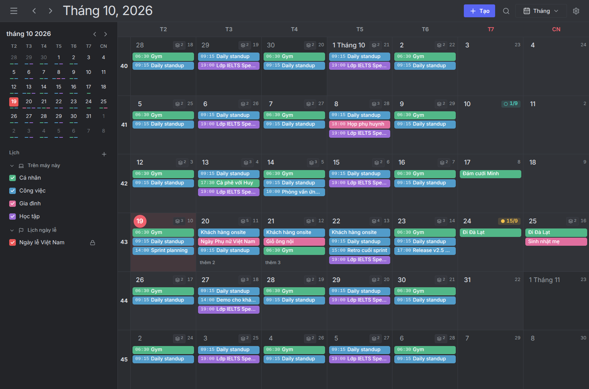
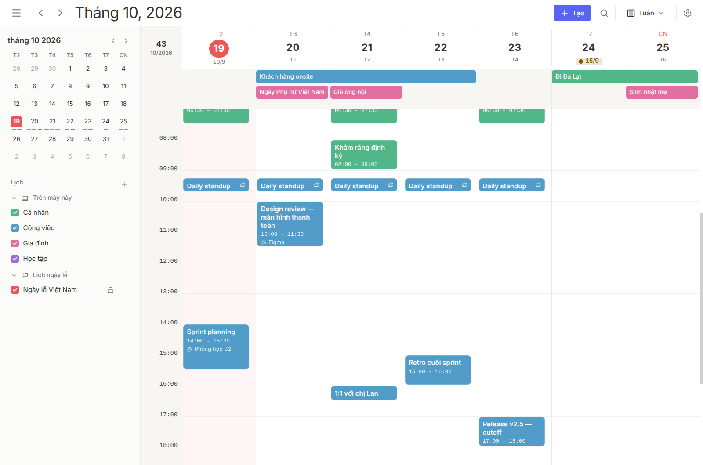
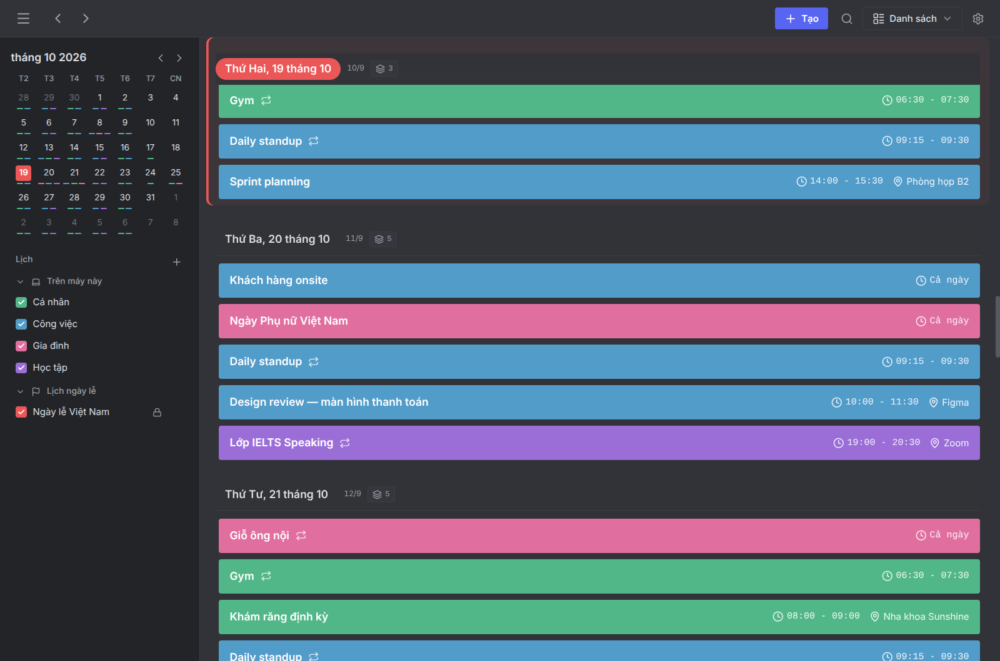
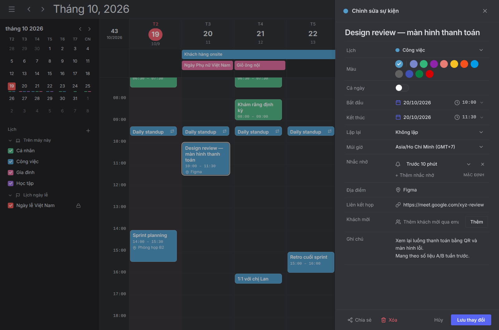
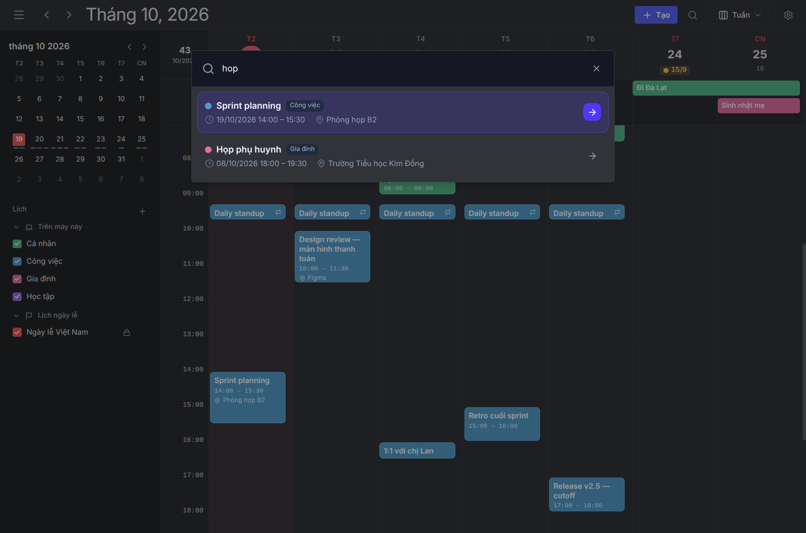
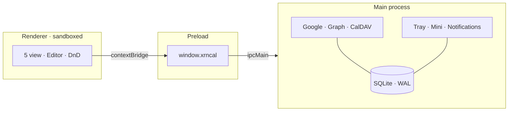

<p align="center">
  
</p>

<h1 align="center">xrncal</h1>

<p align="center">
  <strong>Lịch desktop local-first cho Windows và Linux.</strong><br>
  Google, Microsoft 365 và CalDAV trong một cửa sổ — kèm <em>lịch âm</em> và <em>giỗ theo năm âm</em>.
</p>

<p align="center">
  
  
  
  
  
  
</p>

<p align="center">
  
</p>

<p align="center">
  <strong>Tiếng Việt</strong> · <a href="README.md">English</a>
</p>

<p align="center">
  <a href="#khác-gì-với-app-lịch-thường">Khác gì?</a> ·
  <a href="#ảnh-màn-hình">Ảnh màn hình</a> ·
  <a href="#cài-đặt">Cài đặt</a> ·
  <a href="#tính-năng">Tính năng</a> ·
  <a href="#kiến-trúc">Kiến trúc</a> ·
  <a href="#phát-triển">Phát triển</a>
</p>

---

## Khác gì với app lịch thường

Phần lớn app lịch là **client của một dịch vụ**, hoặc là **tab web đóng gói lại**. xrncal đi hướng khác: dữ liệu nằm trong SQLite trên máy bạn, các provider chỉ là nơi đẩy đi / kéo về.

### 1. Âm lịch là công dân hạng nhất, không phải plugin

Đây là lý do app này tồn tại.

- Nhãn âm lịch hiện trên **mọi view** — ô ngày trong Tháng, header Tuần và Ngày, nhóm ngày trong Danh sách, lưới Năm. Mùng 1 và rằm được đánh dấu, mỗi ngày một màu và một hình riêng.
- **Giỗ / ngày âm lặp hằng năm** là một loại sự kiện thật sự: bạn khai báo *"12 tháng 8 âm"*, app tự giải ra ngày dương cho **từng năm**, xử lý cả tháng nhuận và tháng thiếu 29 ngày.
- Google Calendar / Outlook / Apple Calendar không có quy tắc lặp theo lịch âm. Cách duy nhất ở đó là tự tra rồi tạo tay từng năm một — sai một năm là trượt cả chuỗi.
- Giỗ được **materialize** thành sự kiện thường trong lịch có sync, nên điện thoại và đồng nghiệp vẫn thấy, dù họ không dùng xrncal.
- Ngày giỗ mới **nhắc bạn từ hôm trước, lúc 09:00** - đủ thời gian sắm lễ - và lời nhắc được đồng bộ sang điện thoại cùng sự kiện.

### 2. Offline là mặc định, không phải chế độ dự phòng

SQLite là **nguồn sự thật cho UI**. Mất mạng vẫn xem, vẫn tạo, vẫn sửa, vẫn xoá; sửa đổi được đánh `dirty = 1` và đẩy lên khi có mạng trở lại. Không có màn hình "không kết nối được".

### 3. Ba nhà cung cấp, một cửa sổ, không ưu tiên ai

Google Calendar, Microsoft 365 / Outlook.com và CalDAV (Nextcloud, Synology, generic) chạy **song song**, mỗi engine có `.catch` riêng — một provider hỏng không chặn hai cái còn lại.

### 4. Xung đột được nói thẳng, không ghi đè im lặng

Mọi update/delete đều gửi kèm precondition `If-Match`. Máy chủ trả `412` nghĩa là bản trên đó đã đổi: hàng đó được đánh dấu xung đột, **loại khỏi hàng đợi đẩy** và hiện ra để bạn chọn — thay vì thử lại rồi thất bại mãi mãi, hoặc đè mất thay đổi của người khác.

### 5. Token nằm trong OS secret store, và fail closed

OAuth token và mật khẩu CalDAV được mã hoá bằng Electron `safeStorage`. Trên Linux không có keyring, app **từ chối lưu** và báo lỗi rõ ràng — không có đường lùi về plaintext. Không telemetry, không tài khoản xrncal, không máy chủ trung gian.

### 6. View viết tay, thao tác bằng chuột đúng nghĩa

Năm view đều là component React tự viết, không dùng thư viện lịch bên thứ ba: kéo-thả, resize mép sự kiện, chọn khoảng thời gian bằng cách quét chuột, bước snap (15 / 30 / 60 phút) chỉnh được trong Settings. Kéo sang lịch khác thì hỏi *Move hay Copy* — và chỉ hỏi khi thao tác thật sự nhập nhằng.

|  | Lịch phổ thông | xrncal |
| --- | --- | --- |
| Âm lịch | Không, hoặc chỉ là nhãn phụ | Trên mọi view + lặp theo năm âm |
| Dữ liệu | Trên máy chủ dịch vụ | SQLite trên máy bạn |
| Offline | Xem là chính | Đọc, ghi, sửa, xoá đầy đủ |
| Nhiều tài khoản | Mỗi dịch vụ một app / một tab | Google + Graph + CalDAV cùng lúc |
| Xung đột sync | Thường là last-write-wins âm thầm | `If-Match` → đánh dấu 412 → bạn quyết |
| Lịch chỉ đọc | Tuỳ UI chặn | Chặn ở tầng repo, không bypass được |

---

## Ảnh màn hình

<table>
<tr>
<td width="50%" valign="top">

<p align="center"><sub><strong>Tuần</strong> — theme sáng, cột số tuần, vạch giờ hiện tại</sub></p>
</td>
<td width="50%" valign="top">

<p align="center"><sub><strong>Danh sách</strong> — gom theo ngày, ngày âm ngay cạnh mỗi ngày</sub></p>
</td>
</tr>
<tr>
<td width="50%" valign="top">

<p align="center"><sub><strong>Editor</strong> — lịch, cả ngày, địa điểm, link họp, khách mời, lặp lại</sub></p>
</td>
<td width="50%" valign="top">

<p align="center"><sub><strong>Tìm kiếm</strong> — FTS5, có dấu tiếng Việt, mở bằng <code>/</code></sub></p>
</td>
</tr>
</table>

<sub>Ảnh chụp từ bản build thật với dữ liệu mẫu.</sub>

---

## Cài đặt

Tải bản mới nhất ở **[Releases](https://github.com/Xernnn/xrncal-desktop/releases/latest)**:

- **Windows 10/11:** `xrncal Setup <phiên bản>.exe`. Khi bộ cài chưa được ký số, SmartScreen sẽ hỏi trước: *More info → Run anyway*.
- **Linux:** `xrncal-<phiên bản>.AppImage`. Cho phép chạy (`chmod +x`, hoặc *Properties → Allow executing*) rồi mở.

Lần mở đầu tiên có ba bước ngắn: ngôn ngữ, vài thiết lập cơ bản (âm lịch, ngày lễ, khởi động cùng máy) và các lịch muốn thêm vào. Bản đã cài tự cập nhật khi có release mới; tắt ở *Cài đặt → Chung → Kiểm tra bản cập nhật*.

### Tự build

Cần **Node.js 23.4+** (khuyên dùng 24 - phần test dùng `node:sqlite` có sẵn trong Node) và Git.

```bash
git clone https://github.com/Xernnn/xrncal-desktop.git
cd xrncal-desktop
npm install
```

#### Linux — cài thành app bấm được từ menu

```bash
npm run app:install
```

Lệnh này build AppImage, đặt vào `~/Applications/xrncal.AppImage`, tạo launcher ở `~/.local/share/applications/xrncal.desktop` rồi refresh menu. Tìm "xrncal" trong app menu là ra. Chạy lại chính lệnh đó mỗi khi muốn cập nhật — nó ghi đè đúng các đường dẫn cũ, và ghi bằng cách `rename` nên **không làm hỏng app đang chạy** (bản đang mở vẫn dùng bản cũ cho tới khi bạn thoát và mở lại).

Muốn tự cầm file AppImage:

```bash
npm run pack:linux     # -> dist/*.AppImage
chmod +x dist/xrncal-*.AppImage
./dist/xrncal-*.AppImage
```

#### Windows

```bash
npm run pack:win       # -> dist/  (NSIS installer, x64)
```

Chạy file `.exe` trong `dist/` để cài. Không có bản macOS.

#### Chạy thẳng bản dev

```bash
npm run dev            # electron-vite, renderer hot-reload
```

### Kết nối tài khoản

CalDAV (Nextcloud, Synology, Fastmail, …) và iCloud chỉ cần địa chỉ + tài khoản (iCloud dùng mật khẩu dành riêng cho ứng dụng).

**Google và Microsoft** đăng nhập qua trình duyệt, dùng một OAuth client: thông tin đăng nhập giúp họ nhận ra ứng dụng. Bản build có sẵn OAuth client thì đăng nhập được ngay. Với bản chưa có, **Thêm tài khoản → Google hoặc Microsoft** sẽ hướng dẫn từng bước để bạn tự tạo, rồi nhập luôn ở đó: không phải sửa file, không phải khởi động lại. Thông tin được mã hóa bằng kho khóa của hệ thống, giống token tài khoản, và secret không bao giờ hiện lại.

Lập trình viên có thể đặt cùng thông tin đó bên ngoài ứng dụng: chép [`.env.example`](.env.example) thành `.env` rồi điền:

```ini
GOOGLE_OAUTH_CLIENT_ID=
GOOGLE_OAUTH_CLIENT_SECRET=
MICROSOFT_CLIENT_ID=
MICROSOFT_CLIENT_SECRET=
```

Với bản tự đóng gói, đặt cùng nội dung đó vào `xrncal.env` trong thư mục dữ liệu (xem bên dưới). Mọi thứ khác — lịch trên máy, CalDAV, iCloud, lịch đăng ký bằng liên kết — vẫn chạy mà không cần chúng. Đăng ký OAuth client và các secret mà workflow release dùng để build: [`docs/deployment-guide.md`](docs/deployment-guide.md).

### Dữ liệu nằm ở đâu

| Hệ | Đường dẫn |
| --- | --- |
| Linux | `~/.config/xrncal/xrncal.sqlite` |
| Windows | `%APPDATA%\xrncal\xrncal.sqlite` |

Mỗi tuần một lần, xrncal cũng tự chép nó vào thư mục `backups` ngay bên cạnh và giữ lại bốn bản gần nhất (**Cài đặt → Chung → Tự động sao lưu**). Bạn có thể tự sao lưu bất cứ lúc nào bằng **Cài đặt → Sao lưu dữ liệu** (ghi ra một file `.sqlite` mở được bằng bất kỳ công cụ SQLite nào), và khôi phục bằng **Cài đặt → Khôi phục từ bản sao lưu**, hộp chọn tệp sẽ mở sẵn ở thư mục sao lưu tự động (dữ liệu hiện tại được lưu vào đó trước). Chỉ tài khoản người dùng của bạn đọc được các bản sao lưu.

Khi có sự cố, **Cài đặt → Mở tệp nhật ký** mở thư mục chứa `xrncal.log`: lần khởi động, lỗi đồng bộ và lúc đồng bộ chạy lại, các bản sao lưu và lỗi cập nhật. Tệp này không bao giờ ghi nội dung sự kiện hay mật khẩu.

> Nâng cấp từ bản **Gone Calendar** cũ: lần chạy đầu tiên xrncal tự chép dữ liệu từ `gone-calendar` sang. Profile cũ vẫn được giữ nguyên tại chỗ.

---

## Tính năng

<table>
<tr>
<td width="50%" valign="top">

**Lịch**
- 5 view: Ngày, Tuần, Tháng, Năm, Danh sách
- Bấm vào ô trống hoặc sự kiện để mở cửa sổ sự kiện đầy đủ, hoặc nút Tạo trên thanh tiêu đề; chuột phải vào sự kiện để sửa, nhân bản hoặc xoá, hoặc vào một ngày để tạo sự kiện ở đó
- Kéo-thả, resize mép, quét chọn khoảng giờ
- Bước snap 15 / 30 / 60 phút, và bước riêng cho danh sách giờ trong cửa sổ sự kiện
- Sự kiện mới dài bao lâu là do bạn đặt (15 phút đến 2 giờ) khi bấm vào ô trống, bấm chuột phải hoặc nút Tạo; khoảng giờ quét chọn thì giữ nguyên độ dài
- Gõ thời gian ngay vào tiêu đề: "Họp 3h chiều thứ 6", "Ăn trưa mai 12h30", "Chạy bộ 6h sáng hàng ngày" tự điền ngày, giờ và lặp lại, tiêu đề lưu không kèm những chữ đó
- Lặp lại: lần này / từ đây trở đi / cả chuỗi
- `Ctrl+Z` hoàn tác lần di chuyển, đổi độ dài, sao chép hoặc xoá
- In tuần hoặc tháng, hay lưu thành PDF: một trang A4, có cả âm lịch
- Sự kiện nhiều ngày, cả ngày, số tuần ISO; tuần bắt đầu từ Thứ hai, Chủ nhật hoặc Thứ bảy
- Cột giờ múi thứ hai cho lịch xuyên quốc gia

</td>
<td width="50%" valign="top">

**Việt Nam & ngôn ngữ**
- Âm lịch trên mọi view; đánh dấu mùng 1, rằm và Tết
- Giỗ lặp theo năm âm, xử lý tháng nhuận, nhắc trước một ngày - hoặc chỉ cần gõ "Giỗ ông 12/8 âm lịch"
- Lịch lễ Việt Nam và quốc tế, subscribe 1 cú bấm
- Giao diện tiếng Việt và English — bản mới cài theo ngôn ngữ, kiểu giờ và ngày đầu tuần của máy

</td>
</tr>
<tr>
<td width="50%" valign="top">

**Đồng bộ**
- Google Calendar (OAuth loopback + PKCE)
- Microsoft 365 / Outlook.com (Graph)
- CalDAV: Nextcloud, Synology, generic
- Sửa một lần xuất hiện cũng được đẩy lên đúng
- Nhắc nhở và danh sách khách đồng bộ hai chiều
- Trả lời lời mời: Có / Có thể / Không
- Đăng ký lịch từ bất kỳ liên kết `.ics` / `webcal://`
- Poll thích ứng: 20s khi đang dùng, 5 phút khi blur
- Bảng xử lý xung đột 412
- Sửa sự kiện CalDAV vẫn giữ những gì ứng dụng khác đã lưu

</td>
<td width="50%" valign="top">

**Chỗ làm việc**
- Vẫn chạy ở khay hệ thống khi đóng cửa sổ, và có thể khởi động cùng máy, nên nhắc nhở luôn kêu (`Ctrl+Q` để thoát)
- Cửa sổ mini luôn-trên-cùng từ khay hệ thống
- Nhắc nhở cho từng sự kiện (kể cả cả ngày), có báo lại và nút Tham gia
- Theme sáng / tối / theo hệ thống, ảnh nền tuỳ chỉnh
- Tìm kiếm không cần gõ dấu ("hop" ra "họp"), gợi ý tiêu đề từ lịch sử của bạn
- Mỗi sự kiện có thể có múi giờ và màu riêng, giữ nguyên khi đồng bộ CalDAV hay xuất .ics; sự kiện lưu không kèm múi giờ (như bản xuất của Google) mở theo múi giờ nơi bạn ở vào ngày đó
- Nhập `.ics` (trong Cài đặt, kéo tệp vào cửa sổ, hoặc *Mở bằng xrncal*) và xuất từng lịch; sao lưu và khôi phục dữ liệu
- Gỡ tài khoản mà vẫn giữ lại sự kiện

</td>
</tr>
</table>

### Phím tắt

Toàn bộ ứng dụng dùng được mà không cần chuột. `↑` `↓` di chuyển con trỏ qua
các sự kiện đang hiển thị; mọi phím còn lại tác động lên sự kiện đang chọn.

| Phím | Việc |
| --- | --- |
| `T` | Về hôm nay |
| `←` `K` · `→` `J` | Kỳ trước · kỳ kế tiếp (hoặc `PgUp` / `PgDn`) |
| `1` `2` `3` `4` `5` | Ngày · Tuần · Tháng · Năm · Danh sách (hoặc `D` `W` `M` `Y` `L`) |
| `↑` `↓` | Sự kiện trước · sự kiện kế tiếp |
| `Enter` | Mở sự kiện đang chọn (hoặc tạo mới) |
| `Del` `⌫` | Xóa sự kiện đang chọn |
| `Shift+↑` `Shift+↓` | Dời sớm hơn · muộn hơn một bước |
| `Shift+←` `Shift+→` | Dời lùi · tới một ngày |
| `Alt+↑` `Alt+↓` | Rút ngắn · kéo dài giờ kết thúc |
| `Ctrl+Z` | Hoàn tác lần di chuyển, đổi độ dài, sao chép hoặc xoá gần nhất |
| `N` hoặc `C` | Tạo sự kiện |
| `Ctrl+K` hoặc `/` | Tìm kiếm |
| `Ctrl+B` | Ẩn / hiện thanh bên |
| `Ctrl+P` | In hoặc lưu PDF |
| `R` | Đồng bộ ngay |
| `,` | Cài đặt |
| `?` hoặc `F1` | Bảng phím tắt |
| `Esc` | Đóng hộp thoại, hoặc bỏ chọn |
| `Ctrl+Q` | Thoát (đóng cửa sổ thì xrncal vẫn chạy ở khay) |

Trong cửa sổ sự kiện, `Tab` đi qua từng ô và mọi bộ chọn đều mở được bằng bàn
phím: `↑` `↓` di chuyển trong danh sách, `Enter` chọn mục đang tô sáng; riêng
lịch ngày còn nhận `←` `→` cho ngày, `PgUp` `PgDn` cho tháng (kèm `Shift` là
năm) và `T` để về hôm nay.

| Phím | Việc |
| --- | --- |
| `Enter` | Lưu ngay từ ô tiêu đề |
| `Ctrl+Enter` | Lưu / tạo sự kiện từ bất kỳ ô nào |
| `Ctrl+⌫` | Xóa sự kiện đang sửa |
| `Esc` | Đóng bộ chọn đang mở, nếu không thì đóng cửa sổ |

---

## Kiến trúc



| Tầng | Thư mục | Việc |
| --- | --- | --- |
| Renderer | `src/renderer` | React 19, 5 view, editor, i18n, theme |
| Preload | `src/preload` | `window.xrncal` có type, sandbox bật |
| Main | `src/main` | SQLite, OAuth, sync, tray, thông báo |
| Shared | `src/shared` | `CalendarEvent`, `XrncalAPI`, âm lịch, ngày lễ |

Renderer **không bao giờ** import `src/main`; IPC là cây cầu duy nhất, và mọi channel được khai báo tập trung trong `src/shared/ipc-contract.ts`. Lịch chỉ đọc (ngày lễ) bị chặn ghi ngay ở tầng repo, không phải ở UI.

---

## Phát triển

```bash
npm run dev            # chạy app, hot-reload renderer
npm run typecheck      # tsc cho main + renderer (chạy trước khi commit)
npm run lint           # ESLint 10 flat config
npm run test           # Vitest — chạy trong Node, không cần Electron binary
npm run test:e2e       # build, rồi Playwright chạy thử app thật
npm run test:caldav    # đồng bộ CalDAV với một Radicale thật (pip install radicale)
npm run build          # bundle production -> out/
```

Chạy một file test: `npx vitest run tests/expand-occurrences.test.ts`. CI chạy lint + typecheck + test + build trên mọi push và PR, chạy thử bản build bằng Playwright, và đồng bộ với một máy chủ Radicale thật.

| Tài liệu | Nội dung |
| --- | --- |
| [Architecture](docs/system-architecture.md) | Process, IPC, luồng dữ liệu |
| [Codebase](docs/codebase-summary.md) | Map thư mục và schema |
| [Standards](docs/code-standards.md) | Naming, quy ước, bảo mật |
| [Design](docs/design-guidelines.md) | Token màu, chrome, motion |
| [Deploy](docs/deployment-guide.md) | Build, đóng gói, đăng ký OAuth |
| [URD](docs/urd.md) · [PDR](docs/project-overview-pdr.md) · [Roadmap](docs/project-roadmap.md) | Phạm vi và quyết định sản phẩm |

---

## Giấy phép

[MIT](LICENSE) © Xernnn.

Dùng `ical.js` (MPL-2.0), `rrule` (BSD-3-Clause) và font Inter (SIL Open Font License 1.1, đóng gói sẵn trong app); còn lại là MIT hoặc ISC. Không có phụ thuộc copyleft lây lan.

---

<p align="center">
  <sub>Electron · React · TypeScript · Tailwind · SQLite · Windows &amp; Linux</sub>
</p>
